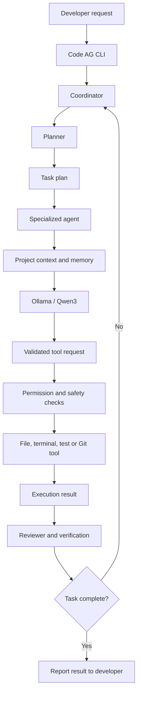

<div align="center">


<h1>⚡ Coder with Code · Code AG</h1>
<h3>Local-first · Agentic · Developer-focused</h3>

<p>
  <a href="https://github.com/dar2006sh8an13/coder-with-code"></a>
  
  
  
  
</p>

<p>
  <a href="#-quick-start"></a>
  <a href="INSTALLATION.md"></a>
  <a href="ARCHITECTURE.md"></a>
  <a href="SECURITY.md"></a>
</p>

**Built in India. Designed for developers everywhere.**

Code AG is a Python-based, local-first AI coding assistant that connects to an Ollama model and coordinates specialized agents for software development tasks. The repository includes modules for project indexing, file operations, controlled command execution, debugging, Git workflows, memory, and monitoring.

</div>

---

## ✨ Why Coder with Code?

Code AG aims to bring an agentic development workflow into a developer-controlled local environment. Instead of treating an LLM response as an executed change, the application uses tools, validation, permissions, and verification steps around model-generated work.

| Capability area | What the project is designed to provide |
|---|---|
| 🧠 Project intelligence | Inspect project structure, detect languages and frameworks, index symbols, and retrieve relevant code context |
| 🧩 Agent orchestration | Coordinate Planner, Code, Debugger, Reviewer, and Coordinator roles |
| ✍️ File operations | Read, create, edit, and delete workspace files through guarded operations |
| 🧪 Execution and testing | Run approved commands and tests, capture results, and report failures |
| 🐞 Debugging | Parse errors, propose minimal patches, request approval, and retest |
| 🌿 Git workflows | Inspect status and diffs, manage branches, and perform controlled commits |
| 🧠 Project memory | Store session and project knowledge in local SQLite storage |
| 🔐 Safety controls | Validate paths and commands, protect sensitive files, create backups, and redact secrets |

> **Status note:** This README describes capabilities documented in this repository. Exact behavior depends on the current implementation and configuration. Review the guides and run the commands locally before relying on a capability in production.

## 🧭 Contents

- [Quick start](#-quick-start)
- [How Code AG works](#-how-code-ag-works)
- [Agent roles](#-agent-roles)
- [Key project modules](#-key-project-modules)
- [Configuration](#-configuration)
- [CLI examples](#-cli-examples)
- [Documentation](#-documentation)
- [Security](#-security)
- [Development and tests](#-development-and-tests)
- [Roadmap](#-roadmap)
- [Contributing](#-contributing)
- [License](#-license)

## 🚀 Quick start

### Prerequisites

- Python **3.12 or newer**
- [Ollama](https://ollama.com/) installed and running
- A model available in Ollama (the documented default is `qwen3:latest`)
- Git

### 1. Clone the repository

```bash
git clone https://github.com/dar2006sh8an13/coder-with-code.git
cd coder-with-code
```

### 2. Create and activate a virtual environment

**Windows PowerShell**
```powershell
py -3.12 -m venv .venv
.\.venv\Scripts\Activate.ps1
```

**Windows CMD**
```cmd
py -3.12 -m venv .venv
.venv\Scripts\activate.bat
```

**Linux / macOS**
```bash
python3.12 -m venv .venv
source .venv/bin/activate
```

### 3. Install Code AG

```bash
python -m pip install --upgrade pip
pip install -e ".[dev]"
```

### 4. Start Ollama and download the model

In a separate terminal, make sure the Ollama service is running:

```bash
ollama serve
ollama pull qwen3:latest
ollama list
```

If Ollama is already running as a background service, you do not need to start a second server process.

### 5. Launch Code AG

```bash
codeag --help
codeag
```

For a quick environment check, consult the CLI reference for the available health and setup commands.

> **Hardware note:** Model memory requirements vary by model quantization and context length. Start with a context size appropriate for your available RAM and VRAM.

## 🔄 How Code AG works

The documented architecture separates agent coordination, project intelligence, model inference, tool execution, and safety checks.



The model proposes actions; application code is responsible for validating and executing tools according to configured policies. Do not interpret an agent plan or generated response as proof that a file change, command, or test succeeded.

## 🤖 Agent roles

| Agent | Responsibility |
|---|---|
| **Coordinator** | Coordinates workflow state, agent hand-offs, and task progress |
| **Planner** | Breaks a developer request into ordered tasks and dependencies |
| **Code** | Implements requested changes using available project tools |
| **Debugger** | Analyses tracebacks and test failures and proposes fixes |
| **Reviewer** | Reviews changes for correctness, safety, and regressions |

The repository documentation describes these roles as sharing a configurable model setup. See [ARCHITECTURE.md](ARCHITECTURE.md) for subsystem details.

## 🧱 Key project modules

The current repository includes the following documented areas:

| Directory | Purpose |
|---|---|
| `codeagent/cli.py` and `codeagent/main.py` | CLI and application entry point |
| `codeagent/config/` | Application settings |
| `codeagent/context/` | Context budgeting and token estimation |
| `codeagent/conversation/` | Conversation/session state |
| `codeagent/agents/` | Agent roles and orchestration |
| `codeagent/filesystem/` | Workspace file operations and path validation |
| `codeagent/execution/` | Controlled command and test execution |
| `codeagent/debugging/` | Traceback analysis and patch workflow |
| `codeagent/indexing/` | Code symbols, chunks, and project search |
| `codeagent/intelligence/` | Project analysis and context construction |
| `codeagent/memory/` | SQLite-based session and project memory |
| `codeagent/git/` | Git operations |
| `tests/` | Automated tests |

For a deeper component map, see [ARCHITECTURE.md](ARCHITECTURE.md).

## ⚙️ Configuration

Code AG documents a four-level configuration precedence:

1. CLI options and flags
2. Environment variables (including a local `.env` file where supported)
3. User configuration
4. Built-in defaults

The documented local inference defaults are:

| Setting | Default |
|---|---|
| Provider/runtime | Ollama |
| Ollama URL | `http://localhost:11434` |
| Model | `qwen3:latest` |
| Context window setting | `8192` tokens |
| Max parallel agents | `2` |

Use the project's configuration guide as the source of truth for supported setting names and options: [CONFIGURATION.md](CONFIGURATION.md).

### API keys and cloud providers

The repository's published configuration documentation describes Ollama as its default inference backend. Do not assume NVIDIA NIM, OpenRouter, or other cloud providers are integrated simply because their API keys are present in an environment file. Cloud-provider support must be implemented and tested before it is advertised as available. Never commit real API keys or secrets.

## 💻 CLI examples

The following commands are documented in the repository's CLI reference. Run `codeag --help` in your installed environment to confirm the commands available in your version.

```bash
# Start the interactive coding session
codeag

# Show command help
codeag --help

# Print version information
codeag version

# Inspect health and runtime status
codeag health

# View monitoring information
codeag monitor

# Inspect effective configuration
codeag config show

# Run an approved command through the tool layer
codeag run "python -m pytest"

# Inspect Git status
codeag git status

# Inspect a Git diff
codeag git diff
```

See [CLI_REFERENCE.md](CLI_REFERENCE.md) for options, subcommands, and interactive commands.

## 📚 Documentation

| Guide | Description |
|---|---|
| [Installation](INSTALLATION.md) | Environment setup for Windows, Linux, and macOS |
| [Quickstart](QUICKSTART.md) | First interactive session and basic workflow |
| [Architecture](ARCHITECTURE.md) | Layers, components, and system interactions |
| [CLI reference](CLI_REFERENCE.md) | Commands, options, and REPL usage |
| [Configuration](CONFIGURATION.md) | Settings, precedence, and secret handling |
| [Security](SECURITY.md) | Safety boundaries and permission practices |
| [Troubleshooting](TROUBLESHOOTING.md) | Common setup and runtime issues |
| [Contributing](CONTRIBUTING.md) | Development workflow and contribution guidance |
| [Changelog](CHANGELOG.md) | Project change history |
| [Research paper](RESEARCH_PAPER.md) | Research and design discussion |

## 🔐 Security

Code agents can affect source files and execute commands. Use this project with appropriate safeguards:

- Keep API keys, tokens, passwords, and private configuration out of source control.
- Review requested file changes and command approvals before accepting them.
- Work on a clean Git branch and keep backups of important projects.
- Do not run the tool with elevated privileges unless required and understood.
- Treat repository files, terminal output, and model-generated content as untrusted input.
- Inspect diffs and run tests before merging or deploying changes.
- Report vulnerabilities privately according to [SECURITY.md](SECURITY.md).

Read the full [Security & Safety Policy](SECURITY.md).

## 🧪 Development and tests

Install development dependencies in the active virtual environment:

```bash
pip install -e ".[dev]"
```

Run the default test suite:

```bash
python -m pytest
```

The project configuration excludes tests marked as `integration` from the default run. Consult the test and contribution documentation before running live tests against Ollama.

## 🗺️ Roadmap

The repository's changelog and documentation describe a phased development effort covering:

- CLI foundation and model integration
- Workspace filesystem intelligence
- Controlled terminal execution and testing
- Autonomous debugging and regression checks
- Project indexing, context retrieval, and persistent memory
- Git integration and safety management
- Multi-agent workflow orchestration
- Monitoring, diagnostics, packaging, and documentation

See [CHANGELOG.md](CHANGELOG.md) for the recorded project history. Roadmap descriptions are not a guarantee that every workflow has been independently validated on every operating system or model.

## 🤝 Contributing

Contributions, bug reports, and documentation improvements are welcome.

1. Read [CONTRIBUTING.md](CONTRIBUTING.md).
2. Open an issue describing the problem or proposed change.
3. Create a focused branch.
4. Add or update tests where appropriate.
5. Run the relevant checks and include their actual results in your pull request.

Please keep changes scoped and avoid including credentials, local databases, model files, or generated runtime data.

## 📄 License

This repository includes a [LICENSE](LICENSE) file. Review it for the exact terms before redistributing or incorporating the project.

---

<div align="center">

**Coder with Code · Code AG**

*Built in India. Designed for developers everywhere.*

<a href="https://github.com/dar2006sh8an13/coder-with-code">Repository</a> ·
<a href="https://github.com/dar2006sh8an13/coder-with-code/issues">Issues</a> ·
<a href="https://github.com/dar2006sh8an13/coder-with-code/blob/main/CONTRIBUTING.md">Contributing</a>

</div>
