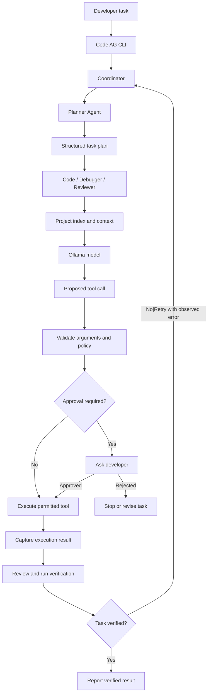

<div align="center">


<h1>⚡ Code AG</h1>
<h3>Autonomous · Local-First · Multi-Agent AI Coding Agent</h3>

<p>
  <a href="https://github.com/dar2006sh8an13/coder-with-code"></a>
  
  
  
  
</p>

<p>
  <a href="#-quick-start"></a>
  <a href="INSTALLATION.md"></a>
  <a href="ARCHITECTURE.md"></a>
  <a href="SECURITY.md"></a>
</p>

**Give Code AG a development task. It can plan the work, use project tools, and report what was actually completed.**

**Built in India. Designed for developers everywhere.**

</div>

---

## 🚀 What is Code AG?

**Code AG is a Python-based, local-first autonomous AI coding agent.** It is designed to work inside a developer's project workspace through a command-line interface, using an Ollama-hosted language model and a set of application-controlled development tools.

Unlike a chat-only code assistant, an agentic coding workflow connects model reasoning to tools: inspect a codebase, create a plan, request or perform permitted file changes, run approved commands, examine results, and verify the outcome.

The repository documents a modular system for project indexing, multi-agent orchestration, guarded filesystem operations, command execution, debugging, Git workflows, persistent memory, and monitoring.

> **Implementation note:** This README describes the architecture and capabilities documented in the repository. It does not claim that every possible autonomous workflow is complete or production-validated. Run the application and tests to verify behavior in your environment.

## 🧠 Coding-agent capabilities

| Area | What Code AG is designed to do |
|---|---|
| **Understand a project** | Scan project structure, detect languages and frameworks, extract symbols, analyse imports, and retrieve relevant code context |
| **Plan development tasks** | Break a request into ordered tasks and coordinate work through specialized agent roles |
| **Write and edit code** | Use guarded filesystem tools to read, create, edit, and delete workspace files |
| **Run development commands** | Execute approved commands and tests through the controlled execution subsystem |
| **Debug failures** | Parse tracebacks, inspect source context, propose minimal patches, and support retesting |
| **Review changes** | Examine proposed code changes for correctness, security, and regressions |
| **Work with Git** | Inspect repository status and diffs, manage branches, and perform controlled commits |
| **Remember project context** | Persist session and project information in local SQLite storage |
| **Protect the workspace** | Apply path and command checks, approval gates, backups, secret redaction, and audit logging |

## 🏗️ Agent architecture

Code AG documents five specialized agent roles coordinated by a shared workflow:

| Agent | Responsibility |
|---|---|
| **Coordinator** | Maintains workflow state, assigns tasks, handles hand-offs, and coordinates completion |
| **Planner** | Converts a developer request into a structured plan and dependencies |
| **Code Agent** | Implements tasks using available project and filesystem tools |
| **Debugger** | Analyses errors and test failures and proposes targeted fixes |
| **Reviewer** | Reviews changes and checks for correctness, security, and regressions |

The agents are application components, not separate model installations by default. The configuration documentation describes a shared model setup with optional per-agent model overrides.

## 🔄 How an agent task flows



**Core safety principle:** The model proposes actions; Code AG validates and executes them. A generated answer is not proof that a file was changed or a test passed. The final report should be based on observed tool and test results.

## ⚡ Quick start

### Requirements

- Python **3.12 or newer**
- [Ollama](https://ollama.com/)
- A local model available in Ollama (the documented default is `qwen3:latest`)
- Git

### 1. Clone Code AG

```bash
git clone https://github.com/dar2006sh8an13/coder-with-code.git
cd coder-with-code
```

### 2. Create a virtual environment

**Windows PowerShell**
```powershell
py -3.12 -m venv .venv
.\.venv\Scripts\Activate.ps1
```

**Windows CMD**
```cmd
py -3.12 -m venv .venv
.venv\Scripts\activate.bat
```

**Linux / macOS**
```bash
python3.12 -m venv .venv
source .venv/bin/activate
```

### 3. Install dependencies

```bash
python -m pip install --upgrade pip
pip install -e ".[dev]"
```

### 4. Prepare the local model

Make sure Ollama is running, then pull the documented default model:

```bash
ollama pull qwen3:latest
ollama list
```

If Ollama is already running as a background service, do not start another server process.

### 5. Run Code AG

```bash
codeag --help
codeag
```

See [INSTALLATION.md](INSTALLATION.md) for the full installation guide and [QUICKSTART.md](QUICKSTART.md) for the first session.

## 💻 Example developer tasks

Once the CLI is running in a project workspace, you can describe the work you need in natural language. Example task prompts:

- "Explain the architecture of this project and identify its entry points."
- "Find why the login test is failing and propose a minimal fix."
- "Add input validation to the registration endpoint and update its tests."
- "Review the current Git diff for possible bugs and security issues."
- "Run the test suite and summarise failures."

These are example prompts, not a guarantee that every task will succeed. Inspect the proposed changes, approve sensitive operations, and verify test results.

## 🧩 Project architecture and modules

| Module | Responsibility |
|---|---|
| `codeagent/cli.py`, `codeagent/main.py` | CLI and application entry point |
| `codeagent/agents/` | Agent roles and orchestration |
| `codeagent/config/` | Application settings |
| `codeagent/context/` | Context budgeting and token estimation |
| `codeagent/conversation/` | Conversation and session state |
| `codeagent/filesystem/` | Workspace file operations and path validation |
| `codeagent/execution/` | Controlled command and test execution |
| `codeagent/debugging/` | Traceback analysis and patch workflow |
| `codeagent/indexing/` | Code symbols, chunks, and project search |
| `codeagent/intelligence/` | Project analysis and context construction |
| `codeagent/memory/` | Persistent session and project memory |
| `codeagent/git/` | Git operations |
| `tests/` | Automated test suite |

Explore [ARCHITECTURE.md](ARCHITECTURE.md) for the detailed component and data-flow description.

## 🔌 Model runtime and provider status

The repository documents **Ollama** as the default local inference backend and `qwen3:latest` as the default model.

| Provider | README status |
|---|---|
| Ollama / Qwen3 | Documented default runtime |
| NVIDIA NIM / Nemotron | Not advertised as integrated by this README |
| OpenRouter | Not advertised as integrated by this README |
| Other cloud APIs | Require implementation and verification before being advertised |

Cloud models can send prompts or source-code context outside the local machine. Any future cloud-provider integration should be opt-in, show which context will be transmitted, protect API keys, and never silently upload private project files.

## ⚙️ Configuration

The configuration guide documents a four-level precedence:

1. Command-line arguments and flags
2. Environment variables
3. User configuration
4. Built-in defaults

The documented local defaults include:

| Setting | Default |
|---|---|
| Ollama endpoint | `http://localhost:11434` |
| Model | `qwen3:latest` |
| Context window setting | `8192` tokens |
| Maximum parallel agents | `2` |

Consult [CONFIGURATION.md](CONFIGURATION.md) for supported environment variables and configuration behavior. Do not assume that setting an API key enables a provider that has not been implemented.

## 🧰 CLI commands

The repository's CLI reference documents commands such as:

```bash
# Start the interactive coding agent
codeag

# Display help
codeag --help

# Show version
codeag version

# Run subsystem health checks
codeag health

# Inspect monitoring information
codeag monitor

# Display resolved configuration (secrets are masked)
codeag config show

# Execute a command through the configured policy layer
codeag run "python -m pytest"

# Inspect Git status and diffs
codeag git status
codeag git diff
```

Check `codeag --help` for the commands available in your installed version. Full reference: [CLI_REFERENCE.md](CLI_REFERENCE.md).

## 🔐 Security and developer control

Coding agents interact with code, tools, and sometimes the terminal. Code AG's documented safeguards include:

- Workspace path validation and protected-path checks
- Command validation and approval policies
- Confirmation gates for sensitive operations
- Pre-modification backups and rollback support
- Secret redaction in logs and diagnostics
- Git secret scanning and controlled staging
- Execution output limits and process management

Always review diffs and approval prompts. Use a dedicated development environment and a clean Git branch. Never put real credentials in source files, prompts, screenshots, logs, or commits.

Read [SECURITY.md](SECURITY.md) and report vulnerabilities privately using the process described there.

## 🧪 Development and tests

Install development dependencies:

```bash
pip install -e ".[dev]"
```

Run the default test suite:

```bash
python -m pytest
```

The project configuration excludes tests marked `integration` from the default run. Consult the test instructions before running integration tests that require a live Ollama service. Do not publish a test pass rate unless the tests have actually been executed and the result recorded.

## 🗺️ Development roadmap

The repository documentation records work across these areas:

- CLI foundation and model integration
- Workspace filesystem tools
- Controlled terminal and test execution
- Autonomous debugging and regression checks
- Project indexing and persistent memory
- Git integration and safety management
- Multi-agent workflow orchestration
- Monitoring, diagnostics, packaging, and documentation

See [CHANGELOG.md](CHANGELOG.md) for the repository's recorded development history. Roadmap items are not promises of completed functionality.

## 📚 Documentation

| Document | What it covers |
|---|---|
| [Installation](INSTALLATION.md) | Environment setup for Windows, Linux, and macOS |
| [Quickstart](QUICKSTART.md) | First interactive session |
| [Architecture](ARCHITECTURE.md) | Subsystems and data flows |
| [CLI reference](CLI_REFERENCE.md) | Commands, flags, and REPL usage |
| [Configuration](CONFIGURATION.md) | Settings and precedence |
| [Security](SECURITY.md) | Safety boundaries and permissions |
| [Troubleshooting](TROUBLESHOOTING.md) | Common setup and runtime issues |
| [Contributing](CONTRIBUTING.md) | Development workflow and PR process |
| [Changelog](CHANGELOG.md) | Project history |
| [Research paper](RESEARCH_PAPER.md) | Research and design discussion |

## 🤝 Contributing

Contributions are welcome.

1. Read [CONTRIBUTING.md](CONTRIBUTING.md).
2. Open an issue describing the bug or proposed change.
3. Create a focused branch.
4. Add or update tests where appropriate.
5. Run relevant checks and include actual results in your pull request.

Keep pull requests focused. Do not commit secrets, virtual environments, model weights, local databases, or generated runtime data.

## 📄 License

See the repository's [LICENSE](LICENSE) file for the exact license terms.

---

<div align="center">

**Code AG — Autonomous AI Coding Agent**

*Built in India. Designed for developers everywhere.*

[GitHub Repository](https://github.com/dar2006sh8an13/coder-with-code) · [Issues](https://github.com/dar2006sh8an13/coder-with-code/issues) · [Contributing](CONTRIBUTING.md)

</div>
