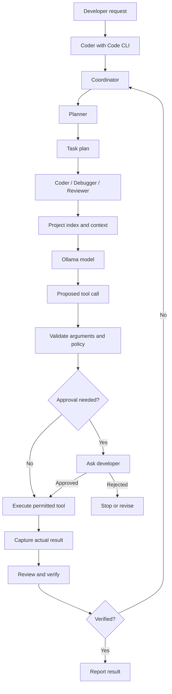

# Coder with Code

<div align="center">


<h2>⚡ Coder with Code</h2>
<h3>Coder with Code · Autonomous · Local-First · Multi-Agent</h3>

<p>
  <a href="https://github.com/dar2006sh8an13/coder-with-code"></a>
  
  
  
</p>

**An AI coding agent that helps developers understand, build, debug, and improve software projects.**

**Built in India. Designed for developers everywhere.**

</div>

---

## What is Coder with Code?

**Coder with Code** is a Python-based, local-first AI coding agent. It connects a language model through Ollama to a collection of application-controlled tools and specialized agent roles.

The goal is to move beyond code suggestions: Coder with Code is designed to inspect a workspace, plan development tasks, use permitted file and terminal tools, analyse failures, and report verification results.

> **Implementation transparency:** This README describes the architecture and capabilities documented in this repository. It does not claim that every workflow is complete or production-validated. Verify behavior with the installed application and test suite.

## What it is designed to do

| Capability | Description |
|---|---|
| Understand codebases | Scan project structure, identify languages/frameworks, index symbols and retrieve relevant code context |
| Plan coding tasks | Break a request into tasks with dependencies |
| Create and edit code | Use workspace tools for guarded file operations |
| Execute and test | Run approved development commands and tests |
| Debug failures | Analyse tracebacks, propose focused patches and support retesting |
| Review changes | Inspect changes for correctness, safety and regressions |
| Work with Git | Inspect status and diffs, manage branches and perform controlled commits |
| Remember context | Store session and project knowledge in local SQLite |
| Protect workspaces | Validate paths and commands, use approval gates, backups and secret redaction |

## Multi-agent system

Coder with Code documents five coordinated agent roles:

| Agent | Responsibility |
|---|---|
| **Coordinator** | Controls workflow state, task hand-offs and progress |
| **Planner** | Converts a developer request into an ordered plan |
| **Coder** | Implements tasks using available project tools |
| **Debugger** | Analyses errors and test failures and proposes fixes |
| **Reviewer** | Reviews changes for correctness, security and regressions |

These are logical agent roles. The configuration guide describes a shared model setup with optional per-agent model overrides.

## How Coder with Code works



**Safety principle:** The model proposes actions; application code validates and executes them. A generated response is not proof that a file was changed or a test passed. Report completion only from observed tool and verification results.

## Quick start

### Requirements

- Python 3.12 or newer
- [Ollama](https://ollama.com/)
- A model available in Ollama (documented default: `qwen3:latest`)
- Git

### 1. Clone the repository

```bash
git clone https://github.com/dar2006sh8an13/coder-with-code.git
cd coder-with-code
```

### 2. Create a virtual environment

**Windows PowerShell**
```powershell
py -3.12 -m venv .venv
.\.venv\Scripts\Activate.ps1
```

**Windows CMD**
```cmd
py -3.12 -m venv .venv
.venv\Scripts\activate.bat
```

**Linux / macOS**
```bash
python3.12 -m venv .venv
source .venv/bin/activate
```

### 3. Install

```bash
python -m pip install --upgrade pip
pip install -e ".[dev]"
```

### 4. Prepare the model

```bash
ollama pull qwen3:latest
ollama list
```

If Ollama is already running as a background service, do not start another server process.

### 5. Launch

```bash
codeag --help
codeag
```

See [INSTALLATION.md](INSTALLATION.md) and [QUICKSTART.md](QUICKSTART.md) for the complete setup instructions.

## Example tasks

Try prompts such as:

- "Explain this project's architecture and identify its entry points."
- "Find why this test is failing and propose a minimal fix."
- "Add input validation to this endpoint and update the tests."
- "Review the current Git diff for security and correctness."
- "Run the test suite and summarise the failures."

These are example prompts, not a guarantee that every task will succeed. Review proposed changes, approve sensitive operations, and verify test results.

## Project structure

| Directory | Purpose |
|---|---|
| `codeagent/agents/` | Agent roles and orchestration |
| `codeagent/config/` | Application settings |
| `codeagent/context/` | Context budgeting and token estimation |
| `codeagent/conversation/` | Conversation and session state |
| `codeagent/filesystem/` | Workspace file operations and path validation |
| `codeagent/execution/` | Controlled command and test execution |
| `codeagent/debugging/` | Traceback analysis and patch workflow |
| `codeagent/indexing/` | Code symbols, chunks and project search |
| `codeagent/intelligence/` | Project analysis and context construction |
| `codeagent/memory/` | Persistent session and project memory |
| `codeagent/git/` | Git operations |
| `tests/` | Automated tests |

See [ARCHITECTURE.md](ARCHITECTURE.md) for subsystem details.

## Models and providers

The repository documents **Ollama** as the default inference runtime and `qwen3:latest` as the default model.

| Provider | Status in this README |
|---|---|
| Ollama / Qwen3 | Documented default |
| NVIDIA NIM / Nemotron | Not advertised as integrated |
| OpenRouter | Not advertised as integrated |
| Other cloud APIs | Require implementation and verification before being advertised |

Cloud-provider integrations should be opt-in, protect API keys, explain what context leaves the local machine, and never upload private source code silently.

## CLI examples

The CLI reference documents commands including:

```bash
codeag
codeag --help
codeag version
codeag health
codeag monitor
codeag config show
codeag run "python -m pytest"
codeag git status
codeag git diff
```

Run `codeag --help` to confirm commands available in your installed version. See [CLI_REFERENCE.md](CLI_REFERENCE.md).

## Security

- Keep keys, tokens and passwords out of source control.
- Review file diffs and approval prompts before accepting changes.
- Use a clean Git branch and maintain backups.
- Avoid running the agent with elevated privileges unless necessary.
- Treat repository content, terminal output and model-generated content as untrusted input.
- Review [SECURITY.md](SECURITY.md) and report vulnerabilities privately through the documented process.

## Development and tests

Install development dependencies:

```bash
pip install -e ".[dev]"
```

Run the default test suite:

```bash
python -m pytest
```

The project configuration excludes tests marked `integration` from the default test run. Consult the test instructions before running integration tests against a live Ollama service. Only publish test results that have actually been run.

## Documentation

- [Installation guide](INSTALLATION.md)
- [Quickstart](QUICKSTART.md)
- [Architecture](ARCHITECTURE.md)
- [CLI reference](CLI_REFERENCE.md)
- [Configuration](CONFIGURATION.md)
- [Security policy](SECURITY.md)
- [Troubleshooting](TROUBLESHOOTING.md)
- [Contributing](CONTRIBUTING.md)
- [Changelog](CHANGELOG.md)
- [Research paper](RESEARCH_PAPER.md)

## Roadmap

The repository's documentation records development across CLI foundations, model integration, workspace tools, controlled execution, debugging, project indexing, persistent memory, Git safety, multi-agent workflows, monitoring, diagnostics and packaging.

See [CHANGELOG.md](CHANGELOG.md) for recorded project history. Roadmap statements do not guarantee that every item is complete.

## Contributing

Contributions are welcome:

1. Read [CONTRIBUTING.md](CONTRIBUTING.md).
2. Open an issue with the bug report or proposal.
3. Create a focused branch.
4. Add or update tests.
5. Run relevant checks and include actual results in the pull request.

Do not commit credentials, virtual environments, model weights, local databases or generated runtime data.

## License

See [LICENSE](LICENSE) for the exact license terms.

---

<div align="center">

**Coder with Code**

*An autonomous AI coding agent. Built in India. Designed for developers everywhere.*

[GitHub](https://github.com/dar2006sh8an13/coder-with-code) · [Issues](https://github.com/dar2006sh8an13/coder-with-code/issues) · [Contributing](CONTRIBUTING.md)

</div>
